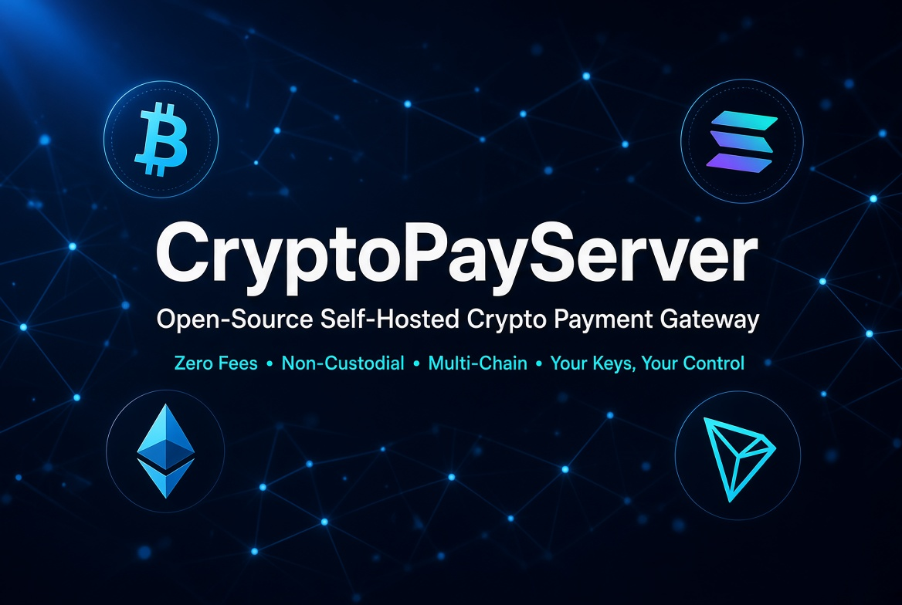

<div align="center">

[](https://cryptopayserver.online/)

# Cryptopayserver

**Open Source Crypto Payment Server**

[Website](https://cryptopayserver.online) · [Live Demo](https://cryptopayserver.online/login) · [FAQ](https://cryptopayserver.online/#faq) · [Docs](https://docs.cryptopayserver.online) · [Telegram](https://t.me/cryptopayserver) · [中文](./README.zh-CN.md)

[](./LICENSE)
[](#contributing)
[](./.github/workflows/ci.yml)

</div>

**Cryptopayserver** is a free, open-source, self-hosted cryptocurrency payment server.  
Accept payments across multiple blockchains and assets — your keys, your data, your control. No tracking, no ads, no middleman fees.

<div align="center">
  
</div>

## Why Cryptopayserver?

- Accept crypto payments across many chains from one dashboard
- Self-custody wallets (mnemonic / private key) — keys stay on your infrastructure
- Built for merchants: invoices, payment requests, pull payments, payouts, webhooks
- Privacy-first — no telemetry, no third-party analytics baked in
- Open source (MIT) and easy to fork or extend

## Features

### Supported chains & networks

| Family | Networks |
| ------ | -------- |
| UTXO | Bitcoin (+ Lightning), Litecoin, Bitcoin Cash |
| Account / ledger | XRP, TON, Tron, Solana |
| EVM | Ethereum, BNB Smart Chain, Arbitrum, Arbitrum Nova, Avalanche, Polygon, Base, Optimism |

Mainnet and testnet can be switched in the app. Chain coverage continues to grow.

### Payments

- **Invoices** — create checkout invoices (UI or API), track status, QR payment flows
- **Payment requests** — reusable / request-style payment links
- **Pull payments** — claimable payouts for refunds, affiliates, or rewards
- **Payouts** — send funds from store wallets with configurable payout settings
- **Reports** — sales and payment reporting for stores
- **Webhooks** — signed notifications for payment events

### Wallets

- Generate or import wallets via mnemonic or private key
- Multi-chain address derivation from a single seed
- Balances, fee estimation, and on-chain / Lightning sends
- Wallet password protection, backup reminders, and revoke / rotate controls
- Lightning backends: LND, Core Lightning, LNBits, LNDHub, Blink, OpenNode

### Stores & account

- Multi-store management tied to wallets
- Checkout, payment, email, notification, and API key settings
- Roles & permissions for team access
- Account security: session cookies, optional **2FA (TOTP)**, password reset via SMTP
- Store **API keys** (`X-API-Key`) for programmatic invoice creation

### Plugins

- Shopify
- Point of Sale
- Pay Button
- Crowdfunding

### Operations

- Background **schedule worker** for block scanning and invoice / request / pull-payment expiration
- Health endpoint: `GET /api/health`
- Optional CoinGecko, Tron, and TON API keys for rates and chain data
- i18n locales under `public/locales` (en, zh, ja, ko, es, fr, pt, ru, hi, …)

## Architecture

```
┌─────────────────┐     ┌──────────────────┐     ┌────────────┐
│  Next.js app    │────▶│  MySQL (Prisma)  │     │  Blockscan │
│  (API + UI)     │     └──────────────────┘     │  / RPCs    │
└────────▲────────┘                               └────────────┘
         │ cron + x-cron-secret
┌────────┴────────┐
│ schedule-worker │
└─────────────────┘
```

- **App**: Next.js (React + API routes), Prisma ORM, MySQL 8
- **Worker**: `scripts/schedule-worker.mjs` calls secured `/api/schedule/*` jobs
- **Auth**: HTTP-only session cookies; API key auth for selected invoice endpoints; CSRF and rate limiting on sensitive routes

## Requirements

- **Node.js** 20+ (18+ may work; CI uses 20)
- **Yarn** 1.x
- **MySQL** 8.0+
- **Docker** + Docker Compose (recommended for production)

## Quick start

### Live demo

Try without installing: **[Live Demo](https://cryptopayserver.online/login)**

### Local development

```bash
git clone https://github.com/cryptopayserver00/cryptopayserver.git
cd cryptopayserver

cp .env.example .env
# Fill SESSION_SECRET, ENCRYPTION_KEY, CRON_SECRET, DATABASE_URL, APP_BASE_URL, etc.
# Generate secrets: openssl rand -base64 48

yarn install
yarn db:generate
yarn db:migrate

# Web only (port 8888)
yarn dev

# Web + schedule worker
yarn dev:all
```

Open [http://127.0.0.1:8888](http://127.0.0.1:8888).

Useful scripts:

| Command | Description |
| ------- | ----------- |
| `yarn dev` / `yarn start` | Dev / production web server (port 8888) |
| `yarn worker` | Run the schedule worker alone |
| `yarn dev:all` / `yarn start:all` | Web + worker together |
| `yarn db:generate` | Generate Prisma client |
| `yarn db:migrate` | Apply migrations (`prisma migrate deploy`) |
| `yarn test` | Unit tests (Vitest) |
| `yarn lint` / `yarn typecheck` | ESLint / TypeScript |

### Docker (recommended)

`docker-compose.yml` runs **app**, **worker**, and **MySQL**. The compose file expects an external Docker network named `shared-network`.

```bash
git clone https://github.com/cryptopayserver00/cryptopayserver.git
cd cryptopayserver

cp .env.example .env.production
# Set MYSQL_ROOT_PASSWORD, DB_*, SESSION_SECRET, ENCRYPTION_KEY, CRON_SECRET, APP_BASE_URL, …

docker network create shared-network   # once

docker compose up -d
docker compose --profile migrate run --rm migrate
```

App listens on host port **8888** → container `3000`. Health check uses `/api/health`.

To build from source instead of the published image, uncomment the `build:` section in `docker-compose.yml` and comment out `image:`.

## Configuration

Copy [`.env.example`](./.env.example) to `.env` (local) or `.env.production` (Docker). Important variables:

| Variable | Purpose |
| -------- | ------- |
| `SESSION_SECRET` | Session / JWT signing (≥ 32 chars recommended) |
| `ENCRYPTION_KEY` | Encrypts sensitive stored secrets |
| `CRON_SECRET` | Authenticates schedule worker (≥ 16 chars) |
| `DATABASE_URL` | Prisma MySQL URL |
| `APP_BASE_URL` | Public base URL (password-reset links; never derived from `Host`) |
| `DISABLE_PUBLIC_REGISTRATION` | Set `true` to close public signup |
| `CORS_ORIGIN` | Optional comma-separated allowed origins |
| `TRUST_PROXY` | `true` only behind a trusted reverse proxy |
| `ENABLE_SCHEDULE_WORKER` / `SCHEDULE_BASE_URL` | Worker on/off and job base URL |
| `SMTP_*` | Optional system SMTP for password reset |
| `BLOCKSCAN_BASE_URL` | Blockchain scan / faucet API |
| `NEXT_PUBLIC_WALLETCONNECT_PROJECT_ID` | WalletConnect (Reown) project id |
| `COINGECKO_AUTH` / `TRON_API_KEY_*` / `TON_API_KEY` | Optional third-party APIs |

Never commit real `.env` / `.env.production` files (they are gitignored). Keep `.env.example` as the template.

## Security notes

- Project is **beta (v0.x)** — see [SECURITY.md](./SECURITY.md)
- Report vulnerabilities privately to **viper.aur123@gmail.com** (do not open public issues)
- Put TLS and rate limiting on a reverse proxy (Caddy / nginx) in production
- Set strong `SESSION_SECRET`, `ENCRYPTION_KEY`, and `CRON_SECRET` before going live
- Prefer disabling public registration after the first admin account exists

## Contributing

Contributions of all kinds are welcome — bug fixes, features, docs, and translations.

- [Report bugs](https://github.com/cryptopayserver00/cryptopayserver/issues/new?template=bug_report.md)
- [Suggest features](https://github.com/cryptopayserver00/cryptopayserver/issues/new?template=feature_request.md)
- [Pull requests](https://github.com/cryptopayserver00/cryptopayserver/pulls)
- [Translations](./public/locales)

CI runs install → Prisma generate → typecheck → lint → tests → build on `main` / `master` and pull requests.

## Sponsors

Love Cryptopayserver? [Sponsor us on GitHub](https://github.com/sponsors/cryptopayserver00) to help the project grow.

## Privacy

Cryptopayserver is self-hosted: your data stays on your infrastructure. There is no telemetry or built-in tracking. See the [Privacy Policy](https://cryptopayserver.online/privacy).

## License

© 2025–2026 [Cryptopayserver](https://cryptopayserver.online)

Open-source software under the [MIT License](./LICENSE).
